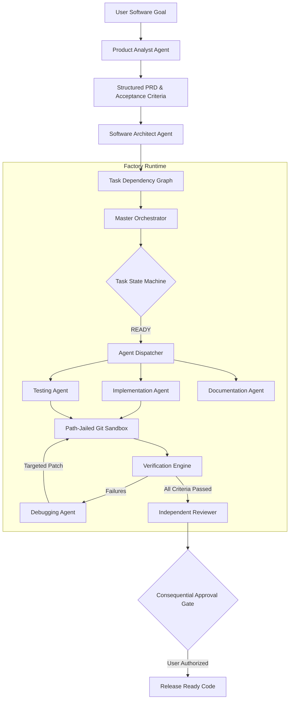

# FORGE AI — Architecture Specification & Engineering Manual

## 1. Executive Architecture Summary

FORGE AI is a model-agnostic autonomous software engineering platform. Rather than relying on chat interactions or unconstrained agent loops, FORGE AI operates as a factory with:
- Strict task lifecycle state machines (`QUEUED` -> `PLANNING` -> `READY` -> `RUNNING` -> `VERIFYING` -> `COMPLETED`)
- Isolated workspace containment with Git version tracking and path jail verification
- Multi-provider model routing (Google Gemini, OpenAI-compatible, Local Ollama, Deterministic Mock)
- Automated verification against observable evidence (exit codes, pass/fail test metrics, syntax trees)
- Bounded self-repair loops with regression prevention
- Cost controls and hard Global Emergency Stop

---

## 2. Subsystem Architecture

---

## 3. Specialized Agent Capabilities

| Agent Role | Primary Mission | Input Artifacts | Output Artifacts |
| :--- | :--- | :--- | :--- |
| **Orchestrator** | Coordinates DAG execution, enforces state transitions, tracks budgets | Task Graph, Project State | State transitions, task dispatches |
| **Product Analyst** | Deconstructs software ideas into unambiguous PRDs | Natural language prompt | PRD, User Stories, Criteria |
| **Software Architect** | Designs schemas, API contracts, and task dependency DAGs | PRD, Memory constraints | Architectural blueprint, Task DAG |
| **Implementation Agent** | Synthesizes source modules within the workspace jail | Task criteria, existing files | Scoped code changes, Git commits |
| **Testing Agent** | Creates automated test suites (pytest/unittest) | Acceptance criteria, source code | Pytest test files |
| **Debugging Agent** | Analyzes tracebacks and generates bounded repair patches | Verification failure logs | Targeted JSON code patches |
| **Independent Reviewer** | Audits diffs for correctness, maintainability, and security | Git diff, criteria | Review approval / findings |
| **Documentation Agent** | Creates system architecture guides and release notes | Project inventory, commits | Markdown documentation |

---

## 4. Security & Isolation Model

1. **Path Jail Containment (`SecurityEngine.validate_path_in_workspace`)**:
   - Rejects directory traversals (`../`, absolute paths outside workspace).
   - Validates that every file operation resolves strictly within the assigned workspace directory.

2. **Command Whitelist Policy**:
   - Permitted: `python`, `pytest`, `ruff`, `node`, `npm`, `git`, `dir`, `echo`, `type`.
   - Blacklisted: `format`, `rmdir /s /q`, `drop database`, `mkfs`, fork bombs.

3. **Secret Redaction**:
   - Automatically sanitizes API keys (`sk-...`, `AIza...`, `ghp_...`, Bearer tokens) before saving logs or streaming to UI.

4. **Approval Gate**:
   - Flags consequential operations (`deploy`, `publish`, `delete_workspace`, `git_push`) for explicit human approval.
